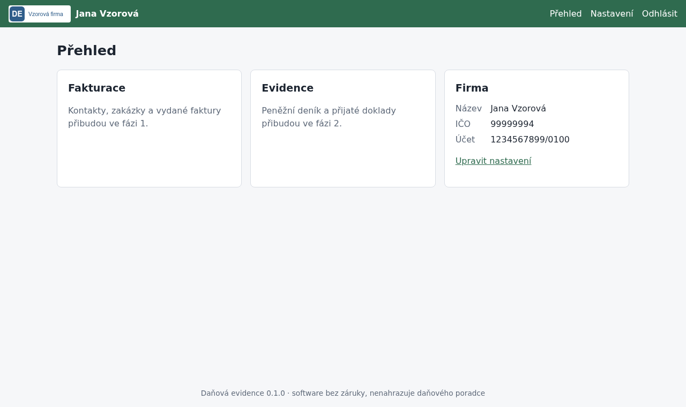

# Daňová evidence

Self-hosted webová aplikace pro daňovou evidenci OSVČ, která není plátcem DPH. Data ukládá do CSV, takže je přečtete i bez ní.

## Co aplikace umí

> Aplikace je ve vývoji. Hotová je fáze 0 (kostra); ostatní body přibývají postupně, viz [CHANGELOG](CHANGELOG.md).

- Přihlášení jedním uživatelem, průvodce prvním spuštěním, vlastní logo a barvy.
- Data v CSV souborech, které otevřete v Excelu nebo Numbers.
- Záznam každé změny do auditního logu.
- Kontakty s načtením údajů z ARES *(fáze 1)*.
- Vydané faktury s PDF, QR platbou a ISDOC, odeslání e-mailem *(fáze 1)*.
- Zakázky a jejich ziskovost *(fáze 1–2)*.
- Peněžní deník a přijaté doklady včetně čtení ISDOC, QR a textu z PDF *(fáze 2)*.
- Stahování dokladů z e-mailu a párování plateb z Air Bank *(fáze 3)*.
- OCR účtenek, majetek a odpisy, roční přehledy, zálohování, instalace na iPhone *(fáze 4)*.

## Co aplikace neumí

- DPH a kontrolní hlášení (je pro neplátce DPH).
- EET (ukládá jen způsob úhrady pro případné pozdější doplnění).
- Podvojné účetnictví a mzdy.
- Přístup z internetu. Běží jen v lokální síti.

## Rychlý start

1. Stáhněte soubory `docker-compose.yml` a `.env.example` a vytvořte složky `data` a `config`.
2. Zkopírujte `.env.example` na `.env` a vyplňte `SECRET_KEY`.
3. Spusťte `docker compose up -d` a otevřete `http://<adresa-serveru>:8000`. Průvodce vás provede nastavením.

Podrobně: [instalace na server](docs/instalace-server.md) nebo [na vlastní počítač](docs/instalace-lokalne.md).

## Dokumentace

- [Instalace na server s Linuxem](docs/instalace-server.md)
- [Instalace na Windows a macOS](docs/instalace-lokalne.md)
- [Konfigurace](docs/konfigurace.md)
- [Zálohování a obnova](docs/zalohovani.md)
- [Aktualizace](docs/aktualizace.md)
- [Formát CSV souborů](docs/csv-format.md)
- [Jak přispět do projektu](CONTRIBUTING.md)

## Upozornění

Software je poskytován bez záruky. Nenahrazuje daňového poradce. Za správnost a úplnost evidence odpovídá uživatel.

## Komerční podpora

Instalaci, úpravy na míru a roční podporu nabízí [topalux.cz](https://topalux.cz).

## Licence

[MIT](LICENSE.md)
