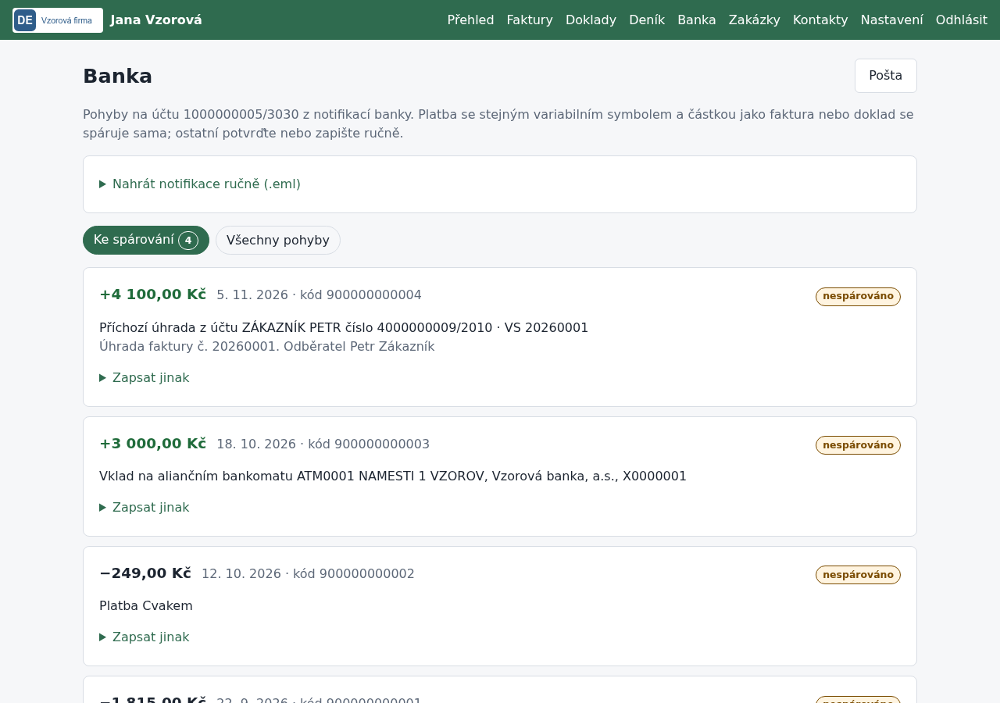

# Banka a pošta: notifikace, párování plateb

## K čemu slouží

Aplikace každých 15 minut stáhne poštu ze schránky pro fakturaci. Notifikace Air Bank
o pohybu na účtu převede na bankovní pohyby a spáruje je s fakturami a doklady. Faktury
a účtenky v přílohách zařadí do fronty *Ke kontrole*. Spárovaná platba se zapíše do
peněžního deníku s kódem transakce jako číslem dokladu.

## Co je potřeba předem

- Vyplněné řádky `IMAP_…` v `.env` (viz [konfigurace](konfigurace.md#příklad-pošta-u-wedos))
  a restart aplikace (`docker compose up -d`).
- V internetovém bankovnictví Air Bank zapnuté e-mailové notifikace o pohybech na
  podnikatelském účtu (*Účty a karty → Možnosti → Info o dění na účtu*) s doručením na tuto schránku.
- Číslo podnikatelského účtu v *Nastavení → Bankovní účet*. Notifikace k jinému účtu aplikace nezpracuje.
- Nastavený začátek peněžního deníku.

## Postup

1. Stahování běží samo. Stránka *Banka → Pošta* ukazuje poslední běh a tlačítko *Stáhnout teď*.
2. Zprávy se třídí takto:
   - **notifikace banky** → bankovní pohyb v *Bance*, přesun do složky *Zpracováno*,
   - **zpráva s PDF, fotkou nebo ISDOC** → doklad v *Doklady → Ke kontrole*, přesun do *Zpracováno*,
   - **ostatní** zůstanou ve schránce k ručnímu posouzení (aplikace je čte jen jednou).
3. Platba se **spáruje sama**, když sedí variabilní symbol i částka (příchozí s vydanou fakturou,
   odchozí s potvrzeným přijatým dokladem).
4. Ostatní pohyby čekají v *Bance* v části *Ke spárování*:
   - **Návrhy:** stejný VS s jinou částkou (částečná úhrada, přeplatek), shodná částka,
     u odchozí platby shodný účet dodavatele, u platby kartou doklad už zaplacený kartou.
     Vyberte správný a klikněte na *Spárovat*.
   - **Zapsat jinak:** pohyb bez dokladu (pojistné, poplatek, úrok) zapíšete do deníku
     s kategorií, vklad hotovosti nebo výběr do pokladny jako převod.
   - **Nezapisovat:** jen pro duplicitu nebo omyl, s uvedeným důvodem.
5. Částečná úhrada nechá fakturu otevřenou, doplatek se spáruje sám. U přeplatku se do deníku
   zapíše skutečně přijatá částka.
6. Chybné spárování vrátíte tlačítkem *Zrušit spárování*; zápis v deníku zmizí.

Notifikace uložené jako `.eml` můžete nahrát i ručně v *Bance → Nahrát notifikace ručně*,
třeba za dobu před nastavením pošty. Stejná transakce se nikdy neuloží dvakrát.

## Jak ověřit, že to funguje

- Po zaplacení faktury odběratelem je do 15 minut faktura *uhrazena*, v deníku je příjem
  s kódem transakce a zakázka je *uhrazeno*.
- Na *Přehledu* se zobrazí *Platby ke spárování*, pokud nějaká čeká.
- Ve schránce přibývají zprávy ve složce *Zpracováno*.

## Časté problémy

- **„Stahování pošty není nastavené“:** chybí `IMAP_HOST`, `IMAP_USER` nebo `IMAP_PASSWORD`.
- **„Připojení ke schránce selhalo“:** zkontrolujte server, port (993) a heslo. U WEDOS je
  server `wesX-imap.wedos.net`.
- **„Pohyb patří k jinému účtu“:** v nastavení je jiné číslo účtu, než ke kterému chodí notifikace.
- **Platba se nespárovala sama:** odběratel zadal jiný VS nebo částku. Spárujte ji z návrhu.
- **Měsíční výpis:** zatím se jen nechává ve schránce. Jeho načítání (sloučení s notifikacemi
  podle kódu transakce) přibude, až bude k dispozici vzor výpisu.
