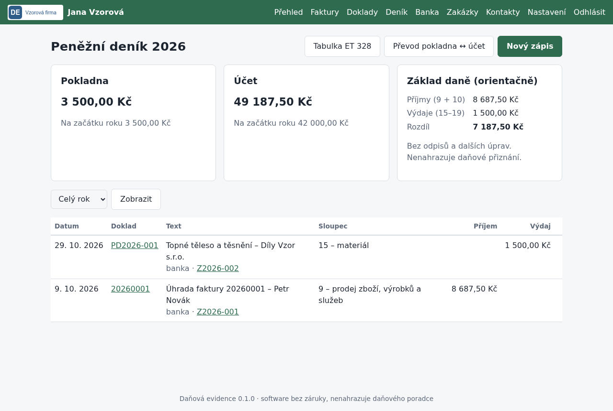

# Peněžní deník

## K čemu slouží

Peněžní deník je hlavní kniha daňové evidence. Aplikace ho vede ve stejném členění jako
tiskopis Baloušek ET 328 (sloupce 1–23), takže součty můžete porovnat s papírovou evidencí.

## Co je potřeba předem

- Začátek evidence v aplikaci a počáteční stavy pokladny a účtu k tomuto dni
  (*Nastavení → Peněžní deník*, nebo krok *Začátek evidence* v průvodci). Pohyby před tímto
  dnem zůstávají v původní evidenci.

## Postup

1. **Úhrady faktur a dokladů** se zapisují samy: při *Označit jako uhrazenou* u vydané faktury
   (sloupec 9) a při úhradě přijatého dokladu (sloupec podle kategorie). Do deníku jde vždy
   datum skutečné úhrady.
2. **Ostatní platby** (tržba v hotovosti, pojistné OSVČ, záloha na daň, osobní spotřeba,
   vklad) zapíšete v *Deník → Nový zápis*: směr, pokladna nebo účet, datum, částka,
   kategorie (sloupec ET 328) a text.
3. **Výběr z účtu do pokladny a vklad z pokladny na účet** zapíšete v *Převod pokladna ↔ účet*.
   Zapíše se jako průběžná položka (sloupce 6 a 7) a neovlivní příjmy ani výdaje.
4. **Fotka dokladu** (příjmový nebo výdajový pokladní doklad, účtenka): přiložíte ji
   při *Označit jako uhrazenou* u faktury, u *Nového zápisu*, nebo dodatečně odkazem
   *Přidat fotku dokladu* u zápisu v pokladně v seznamu deníku a u uhrazené faktury.
   Na telefonu tlačítko nabídne fotoaparát. Přijímá se JPEG, PNG a PDF; fotka se uloží do
   `data/RRRR/pokladna/` a otevřete ji odkazem *📎 Doklad*. Přijaté doklady mají vlastní
   soubor, k nim se fotka nepřikládá.
5. **Tabulka ET 328** ukazuje rok ve všech 23 sloupcích s měsíčními součty a řádkem
   *převedeno*. Vytisknete ji z prohlížeče na šířku.

Číslo dokladu ve sloupci *b*:

- **Pohyb na účtu:** kód transakce z notifikace banky. Zadáte ho do pole *Kód transakce* při
  úhradě faktury, dokladu nebo u ručního zápisu. Když ho nevyplníte, použije se číslo faktury
  nebo přijatého dokladu, u pohybu bez dokladu `B1`, `B2`…
- **Pokladna:** příjmový `PPD1/27` nebo výdajový `VPD1/27` pokladní doklad (pořadové číslo /
  poslední dvojčíslí roku; každý rok začíná od 1). Čísluje aplikace sama v pořadí zadání.
  Když číslo nesedí s papírovým dokladem, opravíte ho odkazem *Opravit číslo* u zápisu
  v deníku nebo u uhrazené faktury (stačí napsat pořadové číslo, např. `3`). Další doklady
  pak navážou na nejvyšší použité číslo. Stejné číslo nesmí mít dva zápisy.

Vazba na fakturu nebo přijatý doklad zůstává ve sloupci `doklad_id` i s kódem transakce.

| Sloupce | Význam | Základ daně |
| --- | --- | --- |
| 9, 10 | Příjmy z podnikání (§ 7 zákona č. 586/1992 Sb.) | ovlivňují |
| 11, 12, 13 | Příjmy zdaněné srážkou, vklady, úvěry, ostatní | neovlivňují |
| 15–19 | Materiál, zboží, mzdy, pojistné za zaměstnance, provozní režie (§ 24) | ovlivňují |
| 20–23 | Majetek nad 80 000 Kč, daň a pojistné OSVČ, splátky, osobní spotřeba (§ 25, § 26) | neovlivňují |

## Jak ověřit, že to funguje

- Na stránce *Deník* sedí zůstatek pokladny a účtu s pokladnou a výpisem z banky.
- V *Tabulce ET 328* je nápis *Kontrolní součty sedí*: součet sloupce 8 = sloupce 9–13,
  součet sloupce 14 = sloupce 15–23 a pohyby v pokladně a na účtu odpovídají příjmům a výdajům.
- Data jsou v `data/RRRR/denik.csv` (popis v [Formátu CSV](csv-format.md)).

## Časté problémy

- **„Evidence v aplikaci začíná…“:** zápis je starší než začátek evidence. Patří do původní
  evidence, nebo upravte začátek v nastavení.
- **„Pokladna má záporný zůstatek“:** chybí příjem do pokladny (tržba, výběr z účtu) nebo je
  některý výdaj zapsán na pokladnu místo na účet.
- **„Přiložte PDF nebo fotku dokladu“:** soubor není JPEG, PNG ani PDF. Na iPhonu zvolte
  v *Nastavení → Fotoaparát → Formáty* volbu *Nejkompatibilnější*, nebo fotku pořiďte přímo
  z formuláře (Safari ji odešle jako JPEG).
- **Fotku nejde přidat v uzamčeném roce:** rok odemkněte v *Ročním přehledu*, přidejte fotku
  a rok znovu zamkněte.
- **Zápis z faktury nebo dokladu nejde smazat:** zrušte úhradu u faktury nebo dokladu,
  zápis zmizí s ní.
- **Základ daně na stránce Deník:** je jen orientační (příjmy 9 + 10 minus výdaje 15–19),
  bez odpisů a dalších úprav. Nenahrazuje daňové přiznání ani poradce.
