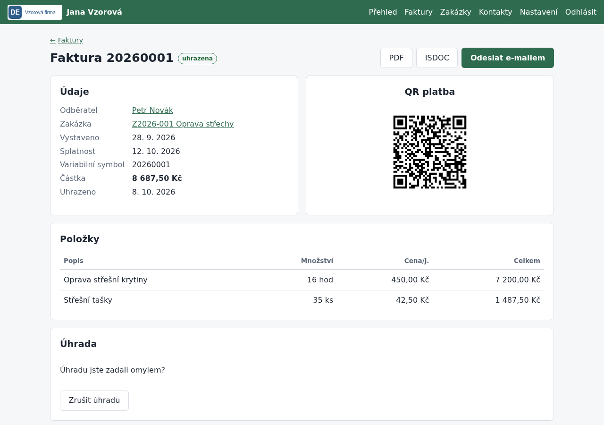

# Fakturace: kontakty, zakázky a vydané faktury

## K čemu slouží

Návod popisuje každodenní práci s fakturami: založení odběratele (i přes ARES), zakázky,
vystavení a oprava faktury s QR platbou, odeslání e-mailem, označení úhrady a storno.

## Co je potřeba předem

- Dokončený průvodce prvním spuštěním: údaje o firmě, bankovní účet a číselná řada.
- Pro odeslání e-mailem vyplněné řádky `SMTP_…` v `.env` (viz [konfigurace](konfigurace.md)).
  Bez nich si fakturu stáhnete jako PDF a pošlete ji z vlastní pošty.

## Postup

### 1. Založte odběratele

1. Otevřete *Kontakty* → *Nový kontakt*.
2. U firmy nebo živnostníka zadejte IČO a klikněte na *Načíst z ARES*. Název, adresa a DIČ
   se vyplní samy. U soukromé osoby nechte IČO prázdné a vyplňte jméno a adresu ručně.
3. Doplňte e-mail, na který chodí faktury.
4. Klikněte na *Uložit kontakt*, nebo rovnou *Uložit a založit zakázku* či *Uložit a vystavit fakturu*.

Uložený kontakt funguje i bez internetu. Údaje z ARES aktualizujete tlačítkem
*Aktualizovat z ARES* v detailu kontaktu.

### 2. Založte zakázku (nepovinné)

1. *Zakázky* → *Nová zakázka*, vyberte zákazníka a vyplňte název.
2. Adresa realizace se předvyplní podle adresy zákazníka.
3. Stav měňte podle průběhu: poptávka → rozpracováno → dokončeno.

Na stav *vyfakturováno* a *uhrazeno* přepne zakázku aplikace sama podle jejích faktur.
Dokončená zakázka bez faktury se zobrazí na *Přehledu* jako upozornění.

### 3. Vystavte fakturu

1. V detailu zakázky nebo kontaktu klikněte na *Vystavit fakturu* (nebo *Faktury* → *Nová faktura*).
2. Zkontrolujte odběratele, zakázku a data. Splatnost se předvyplní podle nastavení.
3. Vyplňte položky: popis, množství, jednotku a cenu za jednotku. Další řádek přidáte tlačítkem
   *Přidat řádek*, prázdné řádky se ignorují. Slevu zadejte jako řádek se zápornou cenou.
4. Celková částka se počítá průběžně. Klikněte na *Vystavit fakturu*.

Číslo faktury přidělí aplikace (řada bez děr, např. `20260001`) a je zároveň variabilním
symbolem. Datum vystavení nesmí být dřív než u poslední faktury téhož roku, aby čísla šla
popořadě. Smazat fakturu nejde, jen stornovat.

### 3a. Opravte vystavenou fakturu

1. V detailu faktury klikněte na *Upravit*. Tlačítko je jen u neuhrazené a nestornované faktury.
2. Pokud jste fakturu už odeslali, aplikace nejdřív zobrazí upozornění, že odběratel má
   původní verzi. Pokračujte tlačítkem *Přesto upravit*.
3. Opravte údaje a klikněte na *Uložit změny*. Číslo faktury zůstane stejné, PDF se vytvoří znovu.
4. Odeslanou fakturu pošlete odběrateli znovu (*Odeslat e-mailem*) a upozorněte ho na opravu.

Datum vystavení musí zůstat ve stejném roce a mezi daty předchozí a následující faktury.
Každá změna se zapíše do `audit.csv` i s původní hodnotou.

### 4. Pošlete fakturu odběrateli

1. V detailu faktury klikněte na *PDF* a zkontrolujte ji.
2. Klikněte na *Odeslat e-mailem*. Adresa, předmět a text se předvyplní; můžete je upravit.
3. Pokud odběratel používá účetní program, zaškrtněte *Přiložit i ISDOC*.
4. Klikněte na *Odeslat*. Faktura dostane stav *odeslana*.

### 5. Označte úhradu

1. Až platba dorazí na účet, otevřete fakturu.
2. V části *Úhrada* zadejte datum, kdy peníze přišly, a klikněte na *Označit jako uhrazenou*.
3. Omylem zadanou úhradu vrátíte tlačítkem *Zrušit úhradu*.

### 6. Stornujte chybnou fakturu

1. V detailu neuhrazené faktury vyplňte v části *Storno* důvod a klikněte na *Stornovat fakturu*.
2. Faktura zůstane v evidenci i se svým číslem, jen je označená jako stornovaná a nemá QR platbu.
3. Vystavte novou, správnou fakturu.

## Jak ověřit, že to funguje

- V seznamu *Faktury* je nová faktura se správnou částkou.
- PDF obsahuje vaše údaje, údaje odběratele, položky, text „Nejsem plátce DPH.“ a QR kód.
- QR kód načtený v bankovní aplikaci ukáže správný účet, částku a variabilní symbol.
  Platbu neodesílejte, jde jen o kontrolu.
- V souboru `data/RRRR/faktury-vydane.csv` je řádek s fakturou
  (popis sloupců v [Formátu CSV](csv-format.md)).

## Časté problémy

- **Načíst z ARES hlásí, že je ARES nedostupný:** server nemá připojení k internetu nebo ARES
  právě nefunguje. Údaje vyplňte ručně a později použijte *Aktualizovat z ARES*.
- **„IČO nemá platný kontrolní součet“:** v IČO je překlep. IČO má vždy 8 číslic.
- **„Datum vystavení nesmí být dřív než u poslední faktury roku“:** faktury se číslují popořadě.
  Použijte datum stejné nebo pozdější než u poslední faktury.
- **Odeslat e-mailem ukazuje jen upozornění:** v `.env` chybí `SMTP_HOST` nebo `SMTP_USER`.
  Postup je v [konfiguraci](konfigurace.md#příklad-pošta-u-wedos).
- **QR kód na faktuře chybí:** v nastavení chybí bankovní účet (IBAN), nebo je faktura stornovaná.
- **Fakturu jsem vystavil omylem:** stornujte ji. Smazat ji nejde, řada čísel musí zůstat bez děr.
- **U faktury chybí tlačítko Upravit:** faktura je uhrazená nebo stornovaná. U uhrazené nejdřív
  použijte *Zrušit úhradu*.
