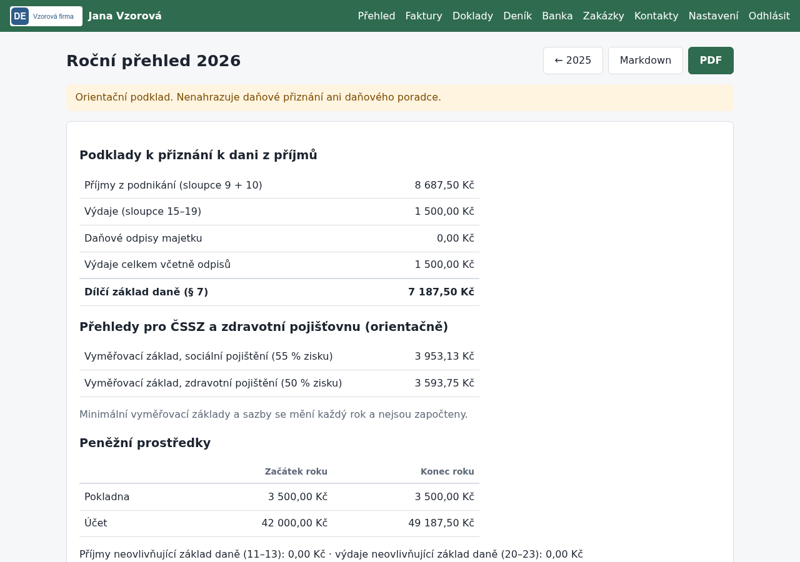

# Majetek, roční přehled a uzamčení roku

## K čemu slouží

Návod popisuje práci na konci roku: evidenci majetku s odpisy, roční přehled jako podklad
pro přiznání k dani z příjmů a přehledy pro ČSSZ a zdravotní pojišťovnu, jeho export
do PDF nebo Markdownu a uzamčení uzavřeného roku proti změnám.

## Co je potřeba předem

- Peněžní deník za celý rok (úhrady faktur, přijaté doklady, ruční zápisy).
- U majetku nad 80 000 Kč doklad o pořízení a zvolená odpisová skupina (příloha č. 1
  zákona o daních z příjmů; např. počítače a nářadí skupina 1, auta skupina 2).

## Postup

### Majetek a odpisy

1. Nákup majetku nad 80 000 Kč zapište jako přijatý doklad v kategorii *20 – nákup DHM*.
   Neovlivní výdaje najednou. V detailu dokladu klikněte na *založte kartu majetku*.
2. Na kartě vyplňte název, datum uvedení do užívání, vstupní cenu, odpisovou skupinu a způsob
   (rovnoměrný podle § 31, zrychlený podle § 32). Aplikace ukáže odpisový plán po letech.
3. Odpisování v některém roce přerušíte tlačítkem *Přerušit* u daného roku (plán se posune).
4. Prodaný nebo vyřazený majetek označte datem vyřazení; v roce vyřazení se uplatní polovina
   ročního odpisu.

Odpisy se zaokrouhlují na celé koruny nahoru. Pravidla odpisování ověřte s daňovým poradcem.

### Roční přehled

1. Otevřete *Deník → Roční přehled* (nebo `/prehledy`).
2. Přehled obsahuje:
   - příjmy (sloupce 9 + 10), výdaje (15–19), odpisy a dílčí základ daně podle § 7,
   - orientační vyměřovací základy pro sociální (55 % zisku) a zdravotní (50 % zisku) pojištění,
   - stav pokladny a účtu na začátku a na konci roku,
   - pohledávky a závazky k 31. 12. (neuhrazené vydané faktury a přijaté doklady),
   - majetek s odpisy a ziskovost zakázek podle úhrad v roce.
3. Tlačítkem *PDF* nebo *Markdown* přehled stáhnete, např. pro daňového poradce.

### Uzamčení roku

1. Po podání přiznání otevřete *Nastavení → Uzamčení roku*, zadejte rok a klikněte na *Uzamknout*.
2. V uzamčeném roce nejde nic zapsat ani změnit: deník, banka, vystavení a úpravy faktur
   a dokladů. Faktury a doklady z uzamčeného roku jde dál označit jako uhrazené (úhrada se
   zapíše do deníku nového roku).
3. Odemknout rok jde jen po napsání jeho čísla do potvrzovacího pole. Zamčení i odemčení se
   zapíše do `audit.csv`.

## Jak ověřit, že to funguje

- Součet *Příjmy* a *Výdaje* v přehledu odpovídá součtům sloupců v *Tabulce ET 328*.
- Odpis na kartě majetku odpovídá tabulce: např. skupina 2 rovnoměrně 11 % v prvním roce,
  22,25 % v dalších letech.
- Zápis do uzamčeného roku skončí hláškou „Rok … je uzamčený“.

## Časté problémy

- **V přehledu chybí příjmy a výdaje:** není nastavený začátek peněžního deníku.
- **„Evidují se jen věci nad 80 000 Kč“:** levnější majetek je přímo výdaj (provozní režie).
- **Přehled je jen orientační:** minimální vyměřovací základy, slevy na dani a další úpravy
  základu daně v něm nejsou. Nenahrazuje přiznání ani daňového poradce.
